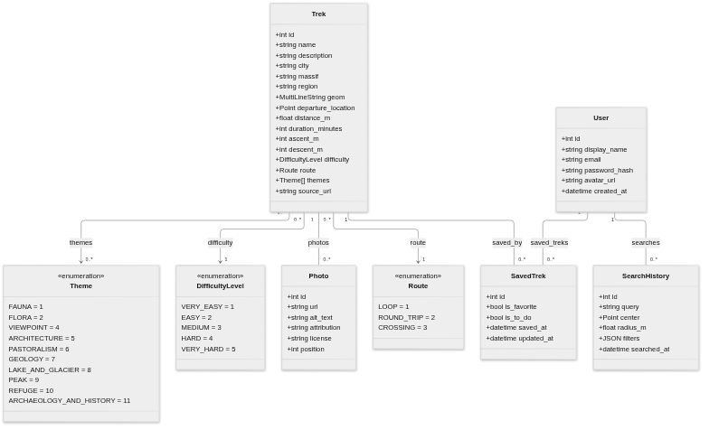

# Specifications

## Functionalities

The following functionalities were extracted from the [client specifications](./references/client-specifications.md):

### MVP

- Search for hikes (city, mountain range, region)
- Filter hikes (difficulty, distance, time, elevation, theme)
- Explore hikes on an interactive map
- Preview and select hikes from a map
- View hike details
- Compare multiple hikes
- Add hikes to favorites
- Save hikes to a “To do” list
- View and organize saved hikes
- View your profile
- View search history
- Sign up
- Log in

### Secondary

- View saved selection history
- Search hikes by point of interests
- View point of interests on a map
- View recently viewed hikes
- Get personalized hike suggestions

## Database

